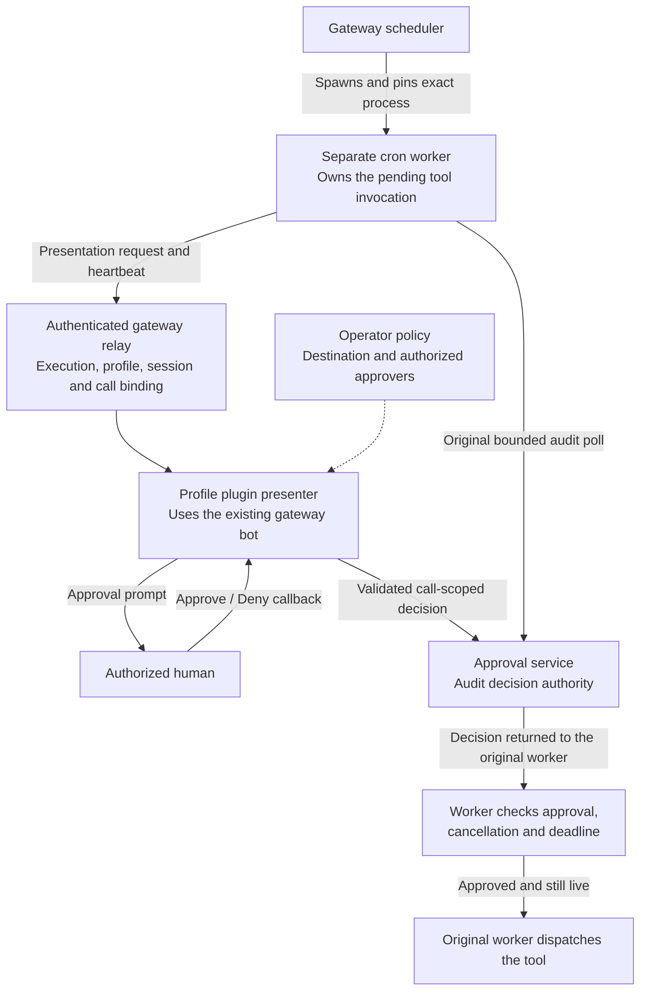

# Cron approval presentation



A restart-safe cron worker owns its execution and tool calls. A gateway plugin can
present that worker's pending approval through an existing platform connection using
`ctx.cron_approvals`. The relay transports presentation and lifetime information only:
it cannot return an approval decision or dispatch a tool.

Selecting a profile selects configuration and available transports. It does not make
the cron session a Telegram sender. `_CronRunScope` still clears `HERMES_SESSION_*`;
job `origin` and result-delivery targets must never become approval authority.

## Plugin contract

This API is for trusted **in-process** plugins. Isolated plugin hosts cannot use it.
The approval plugin must already be loaded for the runtime profile **in the gateway**.
A job in a profile's cron store does not load its gateway plugins. Secondary profiles
must be served/discovered by that gateway (normally `gateway.multiplex_profiles: true`)
or run their own gateway. An undiscovered profile retains its external audit wait;
the relay never borrows another profile's presenter or starts another bot connection.
Register a gateway presenter during plugin registration:

```python
from contextlib import contextmanager

def register(ctx):
    @contextmanager
    def present(request, lifetime):
        # Select transport and approvers from protected operator policy.
        # Present only through the gateway's existing platform application.
        # Each callback must check lifetime before and after decision I/O.
        lifetime.check()
        prompt = open_presentation(request, lifetime)
        try:
            yield
        finally:
            retire_presentation(prompt)

    handle = ctx.cron_approvals.register_presenter(present)
```

The callback receives a frozen `ApprovalRequest`: `profile_home`, `job_id`,
`execution_id`, `session_id`, `external_session_id`, `call_id`, `invocation_id`, and
`deadline` (absolute monotonic time on this host). The deadline cannot be extended;
presentation is capped at 600 seconds even if the original audit wait is longer.
`ApprovalLifetime` provides `check()`, `remaining_seconds`, `request(operation)`,
and an `ended` event. Its terminal reason is latched. A replacement registration or
plugin unload invalidates old presentations; an abandoned loader cannot register one.
The host restores the presenter's captured profile context on its callback thread.

In the supervised worker, keep the original bounded audit poll inside:

```python
with ctx.cron_approvals.pending(
    session_id=current_session_id,
    external_session_id=audit_session_id,
    call_id=pending_call_id,
    deadline=invocation.deadline,
    check=invocation.check,
):
    decision = poll_original_audit(invocation)
invocation.check()
# Only the original invocation's existing guard may decide to dispatch here.
```

`ctx.cron_approvals.is_worker` indicates an available supervised-worker context.
Presentation setup failures leave the original bounded audit wait available. They
never imply approval. Invocation cancellation affects only its own connection.
The scheduler binds the actual agent, so compression may rotate its session ID;
request arguments alone cannot rebind it. Nested cron runs cannot use or replace
the outer execution's channel.

## Authentication and ownership

On Linux, the spawning scheduler creates an ephemeral abstract Unix
`SOCK_SEQPACKET` listener for one execution. It pins the actual spawned PID,
UID, and process start time **before** accepting requests. `SO_PEERCRED` authenticates
the connection; `SO_PASSCRED`/`SCM_CREDENTIALS` authenticate every packet, so a child
that inherits an open descriptor cannot impersonate its parent. The worker also
authenticates the gateway. See the [Linux Unix socket contract](https://www.man7.org/linux/man-pages/man7/unix.7.html).

The payload contains a non-secret locator, not an authorization token. Writable
ack files, the execution ledger, job origin, and matching UID alone grant no
authority. Installed worker/gateway/plugin code and process debugging permissions
remain inside the trusted host boundary; this is not a sandbox for injected Python
or a privileged process capable of forging kernel credentials.

Frames are at most 8 KiB. At most 16 connections and 1,024 distinct invocations
are admitted per execution; duplicate fences are never evicted to make room.
Unexpected fields, extended/expired deadlines, unknown plugin generations,
foreign sessions, transferred descriptors, and different process identities fail closed.

## Lifecycle and fallback

| Event | Presentation | Original execution |
|---|---|---|
| Authorized button | Plugin records a call-scoped audit decision | Original poll and cancellation checks decide whether to proceed |
| Worker cancellation, deadline, or exit | Retired; late callbacks cannot authorize dispatch | Existing worker cancellation/deadline policy applies |
| Gateway disconnect/restart or plugin unload | Retired; no recovery or prompt replay | Worker may survive and keep its bounded external approval wait |
| Ambiguous send | No automatic retry; call fence remains | External audit wait remains available |
| Unsupported host or no registered presenter | No relay presentation | Existing behavior remains available |

Heartbeats run every 0.5 seconds; a missing heartbeat retires presentation after
3 seconds. Callbacks must check lifetime themselves, including after network I/O.
A decision racing cancellation may still be recorded in the audit, but cannot bypass
the original invocation's final cancellation check.

Gateway restart does not reconstruct approval authority from disk or adopt old
channels. Ordinary cron result delivery still uses its separate durable delivery
queue. A plugin must retire **presentation only** on channel loss, not convert a
still-pending external audit into a denial. Destination, actor, bot, topic, message,
and call validation remain the approval plugin's responsibility.

Session injection was not reused: it starts another agent turn rather than resuming
the blocked invocation. The cron result queue was not reused: it has no authenticated
pending-invocation protocol. No model tool, Telegram poller, behavior env var, or
generic remote RPC interface is added.
